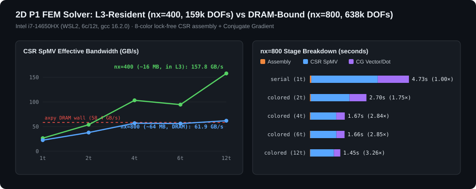
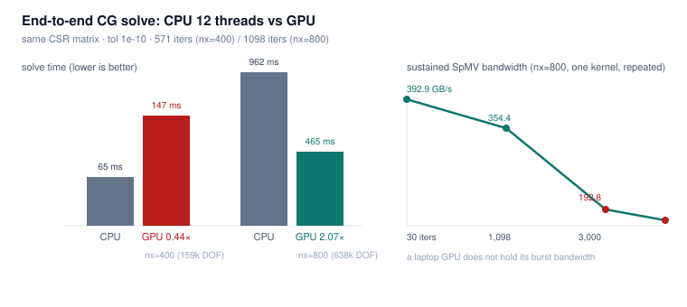

# fem-diffusion-cuda

> **Why I wrote this:** My grad work started in COMSOL multiphysics simulation (PEM water
> electrolysis), where everyone assumes element matrix assembly is expensive because element loops
> look ugly. Before tuning anything by gut feel, I wrote a standalone 2D P1 FEM diffusion solver in C
> and CUDA to break down every millisecond—and see where assembly, SpMV, host synchronization, and
> preconditioning actually move the needle.



## What is inside

- **Unstructured CSR assembly from triangular P1 elements**: solves `-∇·(k(x)∇u) = f` on `[0,1]²`
  (`u = 0` on `∂Ω`) for both uniform (`k=1`) and graded conductivity (`--graded`, `k(x) = 1 + 49x²`,
  a 50× material contrast mimicking porous-layer conductivity gradients).
- **Three CPU modes over identical CSR sparsity**:
  - `serial` — single-threaded assembly + (P)CG (`tol = 1e-10`)
  - `omp_atomic` — OpenMP element loop protected by `#pragma omp atomic`
  - `omp_colored` — **8-color lock-free element batching** (zero shared vertices within any color,
    zero atomics, bit-identical CG convergence to `< 8.6e-15` of serial)
- **Jacobi preconditioned CG (`--precond`)**: cuts iterations by **2.96×** when conductivity varies 50×.
- **Two GPU CG implementations** over the exact CPU-assembled CSR (`--export`):
  - `src/spmv_cuda.cu`: `scalar` / `two_rows` / `warp` CSR SpMV kernels
  - `src/cg_cuda.cu` (v1): 3 host-synchronized dot products per iteration
  - `src/cg_cuda_dev.cu` (v2): reductions and `alpha`/`beta` kept on device (`--sync-every 20`)
- **Verification before timing**: `make test` checks `4.00×` `O(h²)` spatial convergence on both
  uniform and graded cases and asserts `||u_omp - u_serial||_∞ < 1e-8`.

## CPU Results (`i7-14650HX`, 6 physical cores / 12 threads, gcc 16.2.0)

Effective CSR SpMV bandwidth uses compulsory traffic `(12·nnz + 16·dof)` bytes per iteration.

### 1. Cache-resident mesh (`nx = 400`, `159,201` DOFs, `1,111,217` NNZ, ~16 MB, 571 CG iters, `L2 = 2.614e-6`)

| mode | threads | total (ms) | speedup | assembly (ms) | SpMV (ms) | vec ops (ms) | SpMV BW |
| --- | --- | --- | --- | --- | --- | --- | --- |
| `serial` | 1 | 486.0 | 1.00× | 17.67 | 333.3 | 134.3 | 27.2 GB/s |
| `omp_colored` | 2 | 240.2 | 2.02× | 10.30 | 168.6 | 60.7 | 53.8 GB/s |
| `omp_colored` | 4 | 127.4 | 3.82× | 7.02 | 87.8 | 31.9 | 103.2 GB/s |
| `omp_colored` | 6 | 131.5 | 3.70× | 5.89 | 96.0 | 29.1 | 94.4 GB/s |
| `omp_atomic` | 12 | 85.1 | 5.71× | 5.19 | 58.9 | 20.4 | 154.0 GB/s |
| `omp_colored` | 12 | **82.2** | **5.92×** | **3.89 (4.55×)** | **57.5** | **20.2** | **157.8 GB/s** |

### 2. DRAM-bound mesh (`nx = 800`, `638,401` DOFs, `4,462,417` NNZ, ~64 MB past L3, 1,098 CG iters, `L2 = 6.535e-7`)

| mode | threads | total (s) | speedup | assembly (ms) | SpMV (s) | vec ops (s) | SpMV BW |
| --- | --- | --- | --- | --- | --- | --- | --- |
| `serial` | 1 | 4.729 | 1.00× | 66.54 | 3.173 | 1.486 | 22.1 GB/s |
| `omp_colored` | 2 | 2.699 | 1.75× | 39.73 | 1.851 | 0.806 | 37.8 GB/s |
| `omp_colored` | 4 | 1.666 | 2.84× | 24.69 | 1.232 | 0.408 | 56.8 GB/s |
| `omp_colored` | 6 | 1.657 | 2.85× | 18.02 | 1.250 | 0.388 | 56.0 GB/s |
| `omp_atomic` | 12 | 1.475 | 3.21× | 20.05 | 1.148 | 0.306 | 61.0 GB/s |
| `omp_colored` | 12 | **1.452** | **3.26×** | **15.92 (4.18×)** | **1.132** | **0.303** | **61.9 GB/s** |

### 3. When material conductivity varies 50× (`k(x) = 1 + 49x²`, `nx = 400`, 12 threads)

| solver | iterations | total (ms) | SpMV (ms) | L2 error |
| --- | --- | --- | --- | --- |
| Unpreconditioned CG (`--graded`) | 3,136 | 453.1 | 308.9 | `3.115e-06` |
| **Jacobi Preconditioned CG (`--graded --precond`)** | **1,061 (2.96× fewer)** | **167.7 (2.70× faster)** | **108.9** | `3.115e-06` |

## GPU Results (`RTX 5070 Ti Laptop, sm_120, CUDA 13.5`)



`fem_solver -n <nx> --export build/m<nx>.csr` writes the assembled CSR, and both GPU CG binaries solve
the exact same matrix:

| case | iters | CPU 12 threads | GPU v1 (`cg_cuda`, host syncs) | GPU v2 (`cg_cuda_dev`, device loop) | v2 vs CPU |
| --- | --- | --- | --- | --- | --- |
| nx=400, 159k DOF | 571 / 580 | 65 ms | 147 ms (**0.44×**) | **56 ms** | **1.15×** |
| nx=800, 638k DOF | 1098 / 1100 | 962 ms | 465 ms (2.07×) | **331 ms** | **2.91×** |

Both GPU versions converge to the same solution as CPU (`sum(x) = 64844.557535290` at 159k,
`259381.230124981` at 638k; relative residual `7.5e-11` and `2.2e-10`).

- **Why v1 lost at 159k DOF:** One SpMV takes ~19 µs; three host-synced dot products per iteration
  accounted for ~93% of step time. Keeping `alpha`/`beta` and reductions on device flipped 0.44× to 1.15×.
- **How often to check convergence (`sync_every`):** Checking every iteration takes 77 ms (`571` iters);
  every 20 takes **56 ms (`580` iters)**; every 50 overshoots to 600 iters (65 ms).
- **Burst vs sustained laptop GPU bandwidth:** SpMV runs at **392.9 GB/s** (matching measured device
  copy bandwidth 392.3 GB/s) over 30 reps, `354.4 GB/s` over 1,098 reps, and **`192.8 GB/s`** over 3,000 reps.

## Four takeaways for CAE engineering

1. **Measure before optimizing assembly:** At `nx=800` (12 threads), assembly is **1.1%** (`15.9 ms`)
   while SpMV (`77.9%`) + vector ops (`20.9%`) consume **98.8%**.
2. **8-color batching beats `#pragma omp atomic` by 21%–25% on assembly** with identical solver convergence.
3. **Crossing L3 exposes the exact DRAM wall from [cuda-omp-roofline](https://github.com/cccjj55/cuda-omp-roofline):**
   CPU SpMV drops from `157.8 GB/s` (in L3) to `56.8–61.9 GB/s` (DRAM, matching CPU `axpy` `58.35 GB/s`);
   GPU SpMV saturates at `392.9 GB/s` (matching GPU copy `392.3 GB/s`).
4. **Once SpMV hits the memory wall, only preconditioning cuts wall time further:** Jacobi PCG drops
   a 50× conductivity-gradient solve from `453 ms → 168 ms` without touching a single kernel instruction.

## Build and run

```bash
make build
make test                                              # uniform + graded O(h^2) convergence checks
./build/fem_solver -n 400 -r 5 --csv > results/fem_400.csv
./build/fem_solver -n 400 -r 3 --graded --precond      # heterogeneous diffusivity + Jacobi PCG
make gpu-bench                                         # CUDA SpMV kernels on exported CSR
make cg-both                                           # runs both GPU v1 (cg_cuda) and v2 (cg_cuda_dev)
```

## License

MIT
